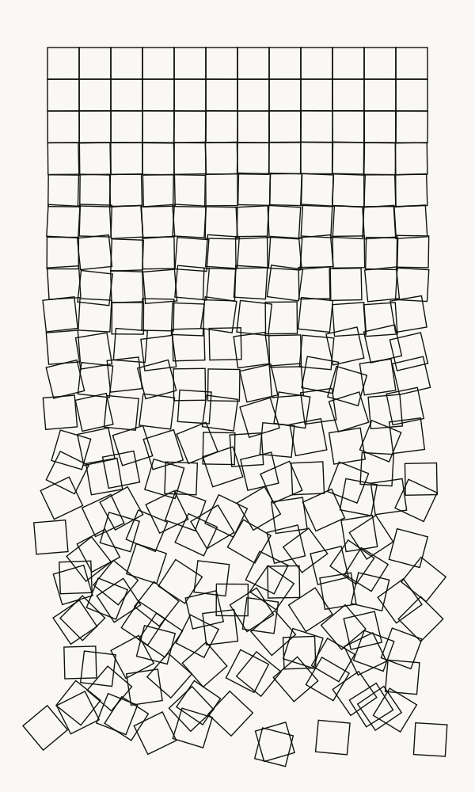

# Schotter

A Python generative art study inspired by Georg Nees’ *Schotter* (1968): an ordered grid of squares gradually becomes displaced and rotated as it descends.



## At a glance

- **Context:** SD5913 Programming for Artists and Designers, The Hong Kong Polytechnic University.
- **Medium:** Python and editable SVG, using only the Python standard library.
- **Focus:** translating a visual idea into explicit rules, using seeded randomness and comparing parameter changes.

## Run it

```bash
git clone https://github.com/Whitter-oy/schotter.git
cd schotter
python3 sketch.py
```

On systems where the Python command is `python`, use `python sketch.py`. No additional packages are required. The script writes `sketch.svg` in the current directory; open it in a browser to view the result.

## How the composition works

The program places squares on a regular grid. For each row, a quadratic disorder factor controls random rotation and displacement:

```python
damage = CHAOS * (row / ROWS) ** 2
```

The top row has no displacement or rotation. Disorder increases further down the image. A fixed random seed makes a given set of parameters reproducible.

## Parameters to explore

| Parameter | Effect |
| --- | --- |
| `COLS`, `ROWS` | Grid dimensions |
| `SEED` | Reproducible random arrangement |
| `CHAOS` | Strength of rotation and displacement |
| `SQUARE`, `MARGIN` | Scale and spacing |
| `STROKE`, `BACKGROUND`, `STROKE_WIDTH` | Colour and line treatment |

In my second version, I changed `CHAOS` from `1.0` to `1.8` so that the lower part of the grid becomes disordered more strongly.

## Context and attribution

This is a coursework interpretation of an existing generative artwork, rather than a claim to the original composition. It forms part of my exploration of code as a design material.
